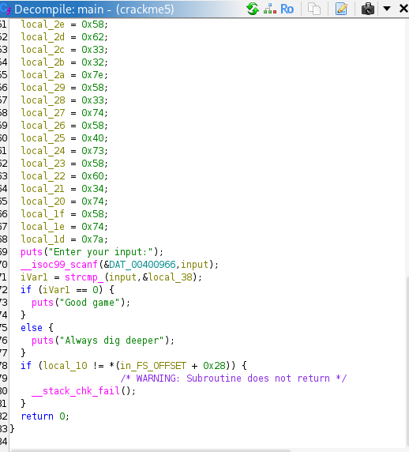
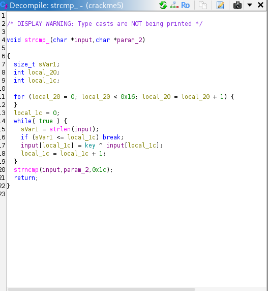
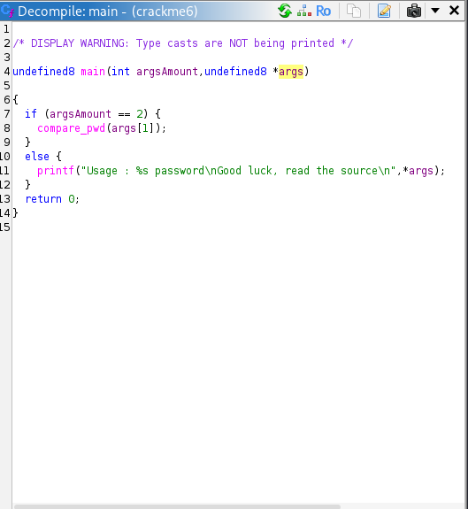
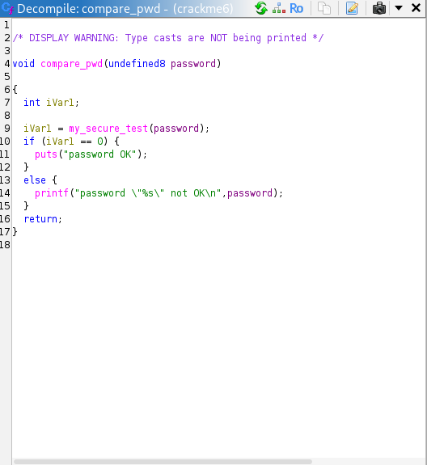
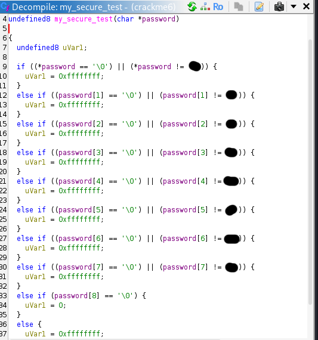
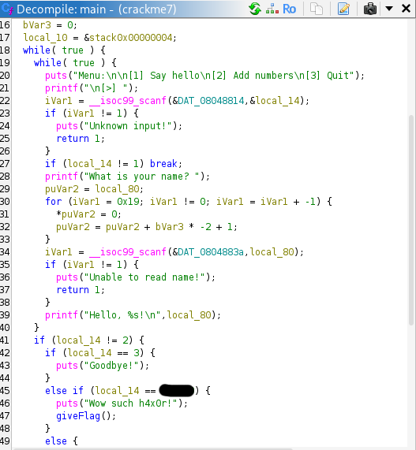
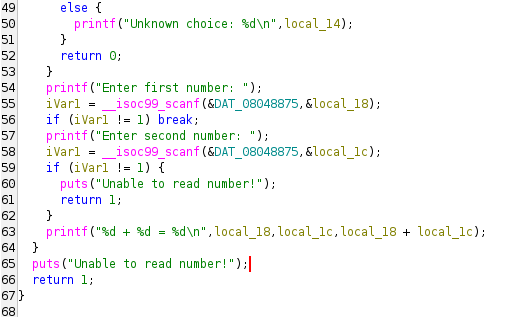
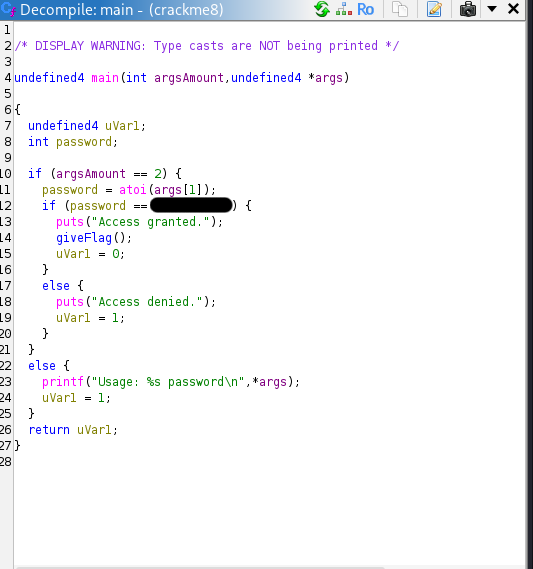

<div align="center">

# TryHackMe: Reversing ELF

</div>

# Crackmes

- [Crackme1](#crackme1)
- [Crackme2](#crackme2)
- [Crackme3](#crackme3)
- [Crackme4](#crackme4)
- [Crackme5](#crackme5)
- [Crackme6](#crackme6)
- [Crackme7](#crackme7)
- [Crackme8](#crackme8)

---

## Crackme1

After giving the file execution permissions (this step is required in all crackme files but will not be mentioned again):

```
$ chmod +x crackme1
```

We can run it and get the flag:

```
$ ./crackme1
flag{REDACTED}
```

---

## Crackme2

After running the executable we see that a password is needed

```
$ ./crackme2
Usage: ./crackme2 password
```

We can run:

```
$ strings crackme2
```

To look for the password in plaintext

```
/lib/ld-linux.so.2
libc.so.6
_IO_stdin_used
puts
printf
memset
strcmp
__libc_start_main
/usr/local/lib:$ORIGIN
__gmon_start__
GLIBC_2.0
PTRh 
j3jA
[^_]
UWVS
t$,U
[^_]
Usage: %s password
REDACTED
Access denied.
Access granted.
;*2$"(
GCC: (Ubuntu 5.4.0-6ubuntu1~16.04.9) 5.4.0 20160609
crtstuff.c
__JCR_LIST__
deregister_tm_clones
__do_global_dtors_aux
completed.7209
__do_global_dtors_aux_fini_array_entry
frame_dummy
__frame_dummy_init_array_entry
conditional1.c
giveFlag
__FRAME_END__
__JCR_END__
__init_array_end
_DYNAMIC
__init_array_start
__GNU_EH_FRAME_HDR
_GLOBAL_OFFSET_TABLE_
__libc_csu_fini
strcmp@@GLIBC_2.0
_ITM_deregisterTMCloneTable
__x86.get_pc_thunk.bx
printf@@GLIBC_2.0
_edata
__data_start
puts@@GLIBC_2.0
__gmon_start__
__dso_handle
_IO_stdin_used
__libc_start_main@@GLIBC_2.0
__libc_csu_init
memset@@GLIBC_2.0
_fp_hw
__bss_start
main
_Jv_RegisterClasses
__TMC_END__
_ITM_registerTMCloneTable
.symtab
.strtab
.shstrtab
.interp
.note.ABI-tag
.note.gnu.build-id
.gnu.hash
.dynsym
.dynstr
.gnu.version
.gnu.version_r
.rel.dyn
.rel.plt
.init
.plt.got
.text
.fini
.rodata
.eh_frame_hdr
.eh_frame
.init_array
.fini_array
.jcr
.dynamic
.got.plt
.data
.bss
.comment
```

When looking at the output we can spot a string resembling a password, when we try using it we get the flag:

```
$ ./crackme2 REDACTED
Access granted.
flag{REDACTEDFLAG}
```

---

## Crackme3

When running the executable we can once again see that a password is needed:

```
$ ./crackme3
Usage: ./crackme3 PASSWORD
```

So, once again we can run strings to look for the password:

```
$ strings ./crackme3
/lib/ld-linux.so.2
__gmon_start__
libc.so.6
_IO_stdin_used
puts
strlen
malloc
stderr
fwrite
fprintf
strcmp
__libc_start_main
GLIBC_2.0
PTRh
iD$$
D$,;D$ 
UWVS
[^_]
Usage: %s PASSWORD
malloc failed
ThisIsAnExampleMadeByDetoured==
Correct password!
Come on, even my aunt Mildred got this one!
ABCDEFGHIJKLMNOPQRSTUVWXYZabcdefghijklmnopqrstuvwxyz0123456789+/
;*2$"8
GCC: (Ubuntu/Linaro 4.6.3-1ubuntu5) 4.6.3
.shstrtab
.interp
.note.ABI-tag
.note.gnu.build-id
.gnu.hash
.dynsym
.dynstr
.gnu.version
.gnu.version_r
.rel.dyn
.rel.plt
.init
.text
.fini
.rodata
.eh_frame_hdr
.eh_frame
.ctors
.dtors
.jcr
.dynamic
.got
.got.plt
.data
.bss
.comment
```

We spot a suspicious base64 encoded looking string right next to the "Correct password!" string. Once decoded the flag is revealed:

```
$ echo "ThisIsAnExampleMadeByDetoured==" | base64 -d  
REDACTEDFLAG
```

---

## Crackme4

When running the executable we get the same prompt to provide a password along with a clue:

```
$ ./crackme4                   
Usage : ./crackme4 password
This time the string is hidden and we used strcmp
```

It's unlikely we'll find the password using strings. Nevertheless, it's worth checking just in case.

```
/lib64/ld-linux-x86-64.so.2
libc.so.6
puts
__stack_chk_fail
printf
strcmp
__libc_start_main
__gmon_start__
GLIBC_2.4
GLIBC_2.2.5
UH-X
UH-X
I]{I
WAGQV
[]A\A]A^A_
password OK
password "%s" not OK
Usage : %s password
This time the string is hidden and we used strcmp
;*3$"
GCC: (Ubuntu 4.8.2-19ubuntu1) 4.8.2
.symtab
.strtab
.shstrtab
.interp
.note.ABI-tag
.note.gnu.build-id
.gnu.hash
.dynsym
.dynstr
.gnu.version
.gnu.version_r
.rela.dyn
.rela.plt
.init
.text
.fini
.rodata
.eh_frame_hdr
.eh_frame
.init_array
.fini_array
.jcr
.dynamic
.got
.got.plt
.data
.bss
.comment
crtstuff.c
__JCR_LIST__
deregister_tm_clones
register_tm_clones
__do_global_dtors_aux
completed.6972
__do_global_dtors_aux_fini_array_entry
frame_dummy
__frame_dummy_init_array_entry
r2.c
__FRAME_END__
__JCR_END__
__init_array_end
_DYNAMIC
__init_array_start
_GLOBAL_OFFSET_TABLE_
__libc_csu_fini
get_pwd
_ITM_deregisterTMCloneTable
data_start
puts@@GLIBC_2.2.5
_edata
_fini
__stack_chk_fail@@GLIBC_2.4
printf@@GLIBC_2.2.5
compare_pwd
__libc_start_main@@GLIBC_2.2.5
__data_start
strcmp@@GLIBC_2.2.5
__gmon_start__
__dso_handle
_IO_stdin_used
__libc_csu_init
_end
_start
__bss_start
main
_Jv_RegisterClasses
__TMC_END__
_ITM_registerTMCloneTable
_init
```

Nothing here, lets try gdb:

```
$ gdb ./crackme4
```

Now lets see all of the functions:

```
(gdb) info functions
All defined functions:

Non-debugging symbols:
0x00000000004004b0  _init
0x00000000004004e0  puts@plt
0x00000000004004f0  __stack_chk_fail@plt
0x0000000000400500  printf@plt
0x0000000000400510  __libc_start_main@plt
0x0000000000400520  strcmp@plt
0x0000000000400530  __gmon_start__@plt
0x0000000000400540  _start
0x0000000000400570  deregister_tm_clones
0x00000000004005a0  register_tm_clones
0x00000000004005e0  __do_global_dtors_aux
0x0000000000400600  frame_dummy
0x000000000040062d  get_pwd
0x000000000040067a  compare_pwd
0x0000000000400716  main
0x0000000000400760  __libc_csu_init
0x00000000004007d0  __libc_csu_fini
0x00000000004007d4  _fini
```

The compare_pwd function seems promising because in order to compare our password to the real one, the real one needs to be loaded. Lets look into it:

```
(gdb) disas compare_pwd 
Dump of assembler code for function compare_pwd:
   0x000000000040067a <+0>:     push   %rbp
   0x000000000040067b <+1>:     mov    %rsp,%rbp
   0x000000000040067e <+4>:     sub    $0x30,%rsp
   0x0000000000400682 <+8>:     mov    %rdi,-0x28(%rbp)
   0x0000000000400686 <+12>:    mov    %fs:0x28,%rax
   0x000000000040068f <+21>:    mov    %rax,-0x8(%rbp)
   0x0000000000400693 <+25>:    xor    %eax,%eax
   0x0000000000400695 <+27>:    movabs $0x7b175614497b5d49,%rax
   0x000000000040069f <+37>:    mov    %rax,-0x20(%rbp)
   0x00000000004006a3 <+41>:    movabs $0x547b175651474157,%rax
   0x00000000004006ad <+51>:    mov    %rax,-0x18(%rbp)
   0x00000000004006b1 <+55>:    movw   $0x4053,-0x10(%rbp)
   0x00000000004006b7 <+61>:    movb   $0x0,-0xe(%rbp)
   0x00000000004006bb <+65>:    lea    -0x20(%rbp),%rax
   0x00000000004006bf <+69>:    mov    %rax,%rdi
   0x00000000004006c2 <+72>:    call   0x40062d <get_pwd>
   0x00000000004006c7 <+77>:    mov    -0x28(%rbp),%rdx
   0x00000000004006cb <+81>:    lea    -0x20(%rbp),%rax
   0x00000000004006cf <+85>:    mov    %rdx,%rsi
   0x00000000004006d2 <+88>:    mov    %rax,%rdi
   0x00000000004006d5 <+91>:    call   0x400520 <strcmp@plt>
   0x00000000004006da <+96>:    test   %eax,%eax
   0x00000000004006dc <+98>:    jne    0x4006ea <compare_pwd+112>
   0x00000000004006de <+100>:   mov    $0x4007e8,%edi
   0x00000000004006e3 <+105>:   call   0x4004e0 <puts@plt>
   0x00000000004006e8 <+110>:   jmp    0x400700 <compare_pwd+134>
   0x00000000004006ea <+112>:   mov    -0x28(%rbp),%rax
   0x00000000004006ee <+116>:   mov    %rax,%rsi
   0x00000000004006f1 <+119>:   mov    $0x4007f4,%edi
   0x00000000004006f6 <+124>:   mov    $0x0,%eax
   0x00000000004006fb <+129>:   call   0x400500 <printf@plt>
   0x0000000000400700 <+134>:   mov    -0x8(%rbp),%rax
   0x0000000000400704 <+138>:   xor    %fs:0x28,%rax
   0x000000000040070d <+147>:   je     0x400714 <compare_pwd+154>
   0x000000000040070f <+149>:   call   0x4004f0 <__stack_chk_fail@plt>
   0x0000000000400714 <+154>:   leave
   0x0000000000400715 <+155>:   ret
```

This line is important:

```
0x00000000004006d5 <+91>:    call   0x400520 <strcmp@plt>
```

Because strcmp needs to access both strings in order to compare them, the arguments passed to the function will contain pointers to the user input and the expected password. By inspecting these values at runtime, we can get the password.

Lets set a breakpoint at this line and run the program (dont forget to provide a password, otherwise you will get the usage prompt):

```
(gdb) b *0x00000000004006d5
(gdb) r 123
Breakpoint 1, 0x00000000004006d5 in compare_pwd ()
```

Now we can take a look at the values.
On x86-64 Linux, the first six function arguments are passed in registers %rdi, %rsi, %rdx, %rcx, %r8, and %r9,
That means the password is either in $rdi or $rsi.
When looking at $rdi we find a string that is not 123.

```
(gdb) x/s $rdi
0x7fffffffdc40: "REDACTED"
```

This is probably the password, lets try it:

```
$ ./crackme4 REDACTED
password OK
```

---

## Crackme5

After checking for strings and using gdb, we didn't find anything, so lets take a look in ghidra.\
\
Looking at the decompiled main function we can see that "Good game" gets output once iVar1 is 0.
iVar1 value is equal to the return value of the function strcmp_, so lets take a look at it.\
\
There is an algorithm that seems to scramble our input, but we can ignore it. The return value of strncmp gets returned to the main function, so all we need to do is make it 0.
We can do that by viewing what strings are being compared using the same method as the one we did in crackme4.

```
$ gdb crackme5

(gdb) disas strcmp_
Dump of assembler code for function strcmp_:
   0x00000000004006d6 <+0>:     push   %rbp
   0x00000000004006d7 <+1>:     mov    %rsp,%rbp
   0x00000000004006da <+4>:     push   %rbx
   0x00000000004006db <+5>:     sub    $0x28,%rsp
   0x00000000004006df <+9>:     mov    %rdi,-0x28(%rbp)
   0x00000000004006e3 <+13>:    mov    %rsi,-0x30(%rbp)
   0x00000000004006e7 <+17>:    movl   $0x0,-0x1c(%rbp)
   0x00000000004006ee <+24>:    movl   $0x0,-0x18(%rbp)
   0x00000000004006f5 <+31>:    jmp    0x400703 <strcmp_+45>
   0x00000000004006f7 <+33>:    addl   $0x1,-0x1c(%rbp)
   0x00000000004006fb <+37>:    xorl   $0x17,-0x1c(%rbp)
   0x00000000004006ff <+41>:    addl   $0x1,-0x18(%rbp)
   0x0000000000400703 <+45>:    cmpl   $0x15,-0x18(%rbp)
   0x0000000000400707 <+49>:    jle    0x4006f7 <strcmp_+33>
   0x0000000000400709 <+51>:    movl   $0x0,-0x14(%rbp)
   0x0000000000400710 <+58>:    jmp    0x40073d <strcmp_+103>
   0x0000000000400712 <+60>:    mov    -0x14(%rbp),%eax
   0x0000000000400715 <+63>:    movslq %eax,%rdx
   0x0000000000400718 <+66>:    mov    -0x28(%rbp),%rax
   0x000000000040071c <+70>:    add    %rdx,%rax
   0x000000000040071f <+73>:    mov    -0x14(%rbp),%edx
   0x0000000000400722 <+76>:    movslq %edx,%rcx
   0x0000000000400725 <+79>:    mov    -0x28(%rbp),%rdx
   0x0000000000400729 <+83>:    add    %rcx,%rdx
   0x000000000040072c <+86>:    movzbl (%rdx),%ecx
   0x000000000040072f <+89>:    mov    0x20092f(%rip),%edx        # 0x601064 <key>
   0x0000000000400735 <+95>:    xor    %ecx,%edx
   0x0000000000400737 <+97>:    mov    %dl,(%rax)
   0x0000000000400739 <+99>:    addl   $0x1,-0x14(%rbp)
   0x000000000040073d <+103>:   mov    -0x14(%rbp),%eax
```

There is no call instruction with the strncmp function name like last time but because the comparison happens right before the value is returned, we can guess that the line we are looking for is the second to last one:

```
0x0000000000400739 <+99>:    addl   $0x1,-0x14(%rbp)
```

Now lets continue just as before

```
(gdb) b *0x0000000000400739
(gdb) r

Enter your input:
123

Breakpoint 1, 0x0000000000400739 in strcmp_ ()

(gdb) x/s $rdi
0x7fffffffdc50: "123"
```

Thats our input, lets check $rsi:

```
(gdb) x/s $rsi
0x7fffffffdc70: "REDACTED"
```

Thats not our input, lets try to use it:

```
$ ./crackme5                        
Enter your input:
REDACTED
Good game
```

---

## Crackme6

When we run the executable we get a clue:
```
$ ./crackme6         
Usage : ./crackme6 password
Good luck, read the source
```
Lets take a look in ghidra:\
\
All the main function does is check if a password was provided, and if so, call the compare_pwd function.
\
This function tells us that my_secure_test(password) needs to return 0 in order for the output to be "password OK"
\
Here we can see a bunch of if statements that compare each character of the password to a hardcoded one, if all of the characters match to their assigned hardcoded character, the function returns 0 and "password OK" will be the output.\
Lets try it:
```
$ ./crackme6 REDACTED
password OK

```

---

## Crackme7

Lets run the executable:

```
$ ./crackme7
Menu:

[1] Say hello
[2] Add numbers
[3] Quit

[>] 1
What is your name? Detoured
Hello, Detoured!
Menu:

[1] Say hello
[2] Add numbers
[3] Quit

[>] 2
Enter first number: 1
Enter second number: 3
1 + 3 = 4
Menu:

[1] Say hello
[2] Add numbers
[3] Quit

[>] 3
Goodbye!
``` 

Nothing, lets take a look at main in ghidra:\
\
\

We can see if statements that correlate to the "Say hello", "Add numbers" and "Quit" options that we saw when we ran the executable.\
But there is another if statement that once reached calls the giveFlag function, seems promising.\
All we need to do is convert the value seen in the decompiled code to decimal and enter that number into the executable.
```
$ ./crackme7
Menu:

[1] Say hello
[2] Add numbers
[3] Quit

[>] REDACTED
Wow such h4x0r!
flag{REDACTEDFLAG}
```

---

## Crackme8

Once again a password is needed:

```
$ ./crackme8           
Usage: ./crackme8 password
```

Lets take a look in ghidra and try to find it:

\

Once again there is an if statement that checks if the password is a certain value. Once the value is converted to decimal, we can use it to get the flag:
```
$ ./crackme8 REDACTED
Access granted.
flag{REDACTEDFLAG}
```
---
